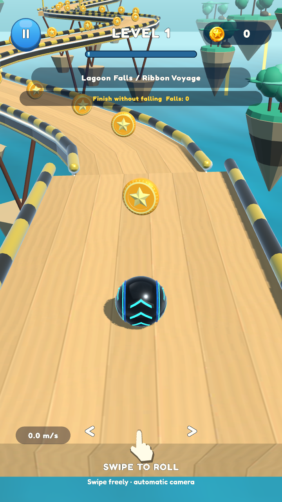
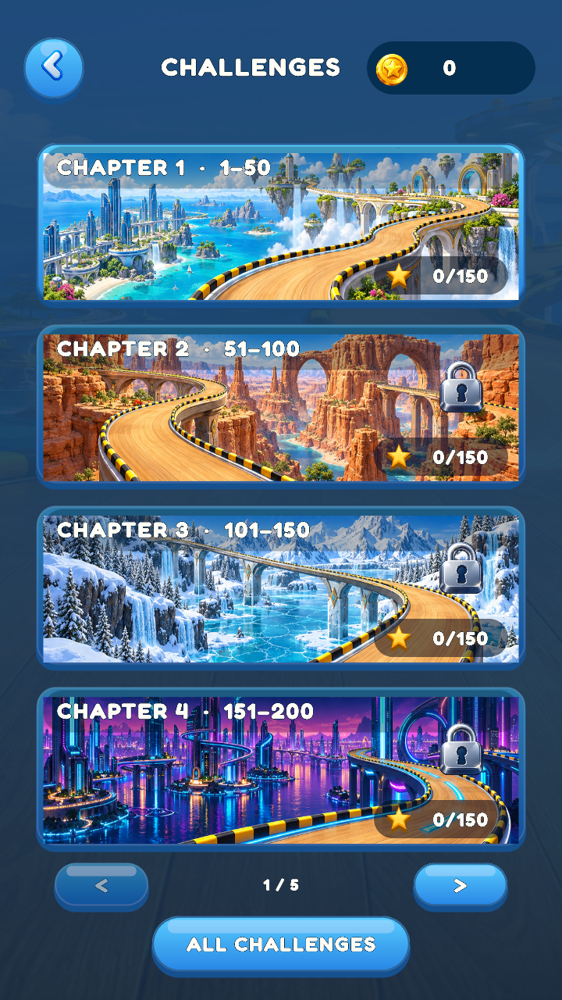

# Ball Quest 3D — Thousand Worlds 0.11.0

Built APKs and test-output folders are not included in this repository. Open the project in Unity 6000.0.65f1 to develop it.

## Screenshots

**Testing build: Ball Quest 3D 0.11.0** — **48.04 MiB**, Android 8+, ARM64. [Delivery notes](Documentation/DELIVERY_V11.md) · the historical verified release record.

- **1,000 consecutive campaign levels**, organized into 20 chapters of 50, with actual route previews and complete pagination.
- **25 topology recipes and 20 environment themes** with parameter and secondary-section variations: helices, hairpins, overpasses, narrow beams, drops, moving bridges, gates, forks and boost sections.
- Five optional bonus objectives: flawless finish, coin hunt, time trial, treasure and boost use. Progress appears in the HUD; each bonus pays once and persists.
- Original generated chapter illustrations and prop concepts, with new native scenery meshes, road materials, lighting and supports.
- Only the active course expands its detailed road geometry. The improved swipe controls, automatic camera, modeled coins/boosters and recorded material audio remain in place.

All **141 distinct current Unity cases passed** after a save-test setup correction. All **1,000 routes passed structural checks**; the **49-course physical sample** spans all layout recipes and environment themes. The 15 special-adventure routes also completed. These are procedural course variations, not 1,000 individually hand-authored topology families.

No Android phone was attached. Human difficulty, feel and sustained device performance remain unverified. The generic BallQuest3D-test.apk is identical to the named APK. Earlier APKs and reports are historical.

[QA and scope](Documentation/QA.md) · [Build handoff](Documentation/BUILDS.md) · [Research and implementation plan](Documentation/DEVELOPMENT_V11.md) · [Generated art prompts](Documentation/ArtDirection/V11/README.md) · [Native world views](Documentation/ArtDirection/V11/NATIVE_VIEWS.md)
